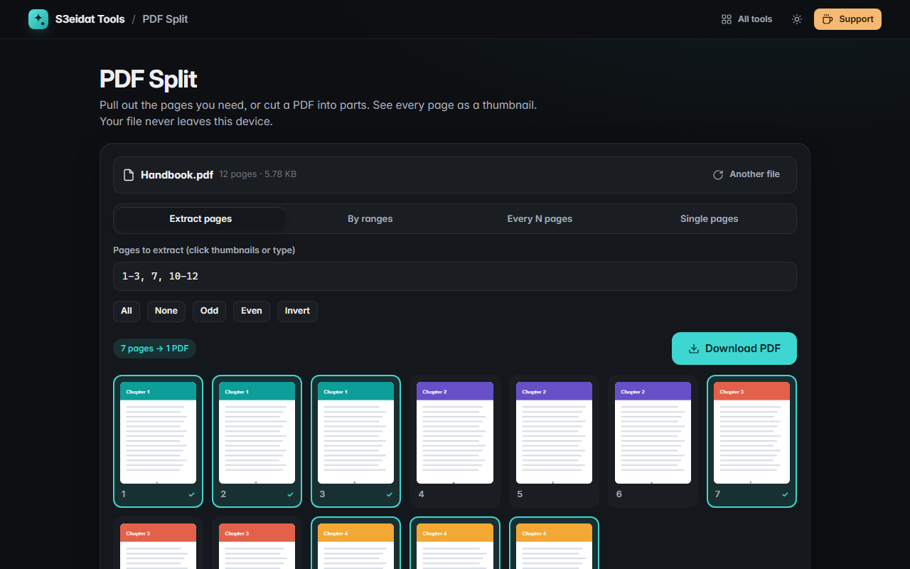

# PDF Split

> Split a PDF or extract pages. Free, private, and it runs entirely in your browser.

### ▶ [Open PDF Split](https://s3eidat.github.io/pdf-split/)



## Features

- **Page thumbnails** of the whole document (rendered lazily, so big files stay fast)
- **Extract pages** into one PDF: click thumbnails (Shift+click for a run), type ranges like `1-3, 5, 9-`,
  or use All / None / Odd / Even / Invert
- **By ranges**: `1-3, 4-7, 8-` gives one PDF per range
- **Every N pages**: cut into equal parts
- **Single pages**: every page as its own PDF
- Several output files come as one **zip**; thumbnails are color-coded by the file each page goes into
- Clear error for **password-protected/encrypted** files

## Privacy

Your PDF never leaves your device: it is read, previewed and split by JavaScript in this tab. There is no server,
no account, no analytics. The page ships with a strict Content-Security-Policy (`connect-src 'self'`), so the browser itself
blocks any attempt to send data anywhere.

## Run it yourself

It's plain HTML, CSS and JavaScript with no build step:

```bash
git clone https://github.com/s3eidat/pdf-split
cd pdf-split
python -m http.server 8000
```

Then open http://localhost:8000.

## Credits

Previews by [PDF.js](https://mozilla.github.io/pdf.js/) (Mozilla, Apache-2.0) and PDF editing by
[pdf-lib](https://pdf-lib.js.org/) (Andrew Dillon, MIT), both shipped in `lib/`.

## Support

If this saved you time, **[buy me a coffee ☕](https://s3eidat.github.io/coffee/)**. It keeps every tool free.

---

Part of **[S3eidat Tools](https://s3eidat.github.io/)**: 100+ free, private tools that run in your browser. MIT licensed.
